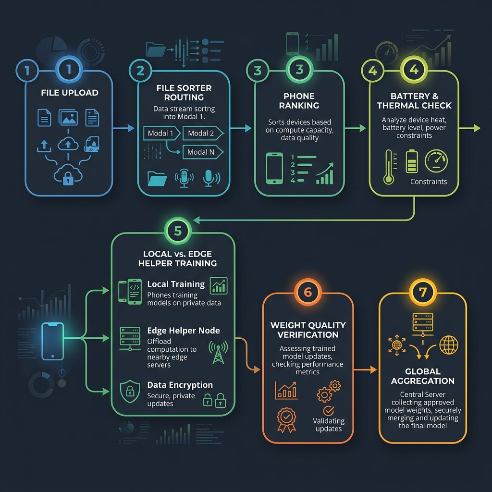
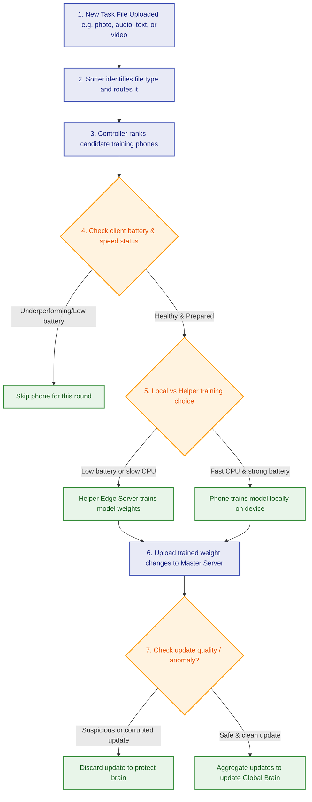

# Simplified Experiment Brief: Multi-Modal Federated Learning with Agentic Offloading

This document explains how our smart training system works in simple, everyday language. It has no programming code or mathematical equations.

---

## 1. How the Training System Flows (Operational Steps)

This flowchart shows how a new training task is sorted, evaluated, executed, and aggregated step-by-step:

## 2. The 7 Phases of the Experiment (Step-by-Step)

Here is what we did in each phase of the project:

### Phase 1: Building the AI Brains (Baseline Models)
We designed four small but smart AI brains—one for images, one for text, one for sound, and one for video. In this phase, we trained them on a single central computer to make sure they are capable of learning and recognizing patterns correctly before we split the system across multiple devices.
*   **Result:** All four brains successfully learned to categorize their respective data formats with high accuracy.

### Phase 2: Combined Team Training (Federated Learning Simulation)
Instead of putting all data on one central computer, we simulated 50 separate phones for each category. The phones train their local AI brain on their own local files, then send only the *learning updates* (not the private files) to the central server. The central server blends these updates together to create a smarter global brain.
*   **Result:** The master AI brains successfully learned from all 50 phones combined, proving that the team training method works.

### Phase 3: Automatic File Sorter (Modality Router)
We created a smart folder sorter. When a new file is uploaded, this sorter automatically checks the file type (like `.png` for image, `.txt` for text, `.wav` for audio, or `.mp4` for video) and directs it to the correct AI training pipeline.
*   **Result:** We tested this with 100 mixed files and it sorted every single one of them into the correct folder with 100% accuracy.

### Phase 4: Smart Battery & Speed Saver (Computation Offloading)
Training AI on a phone can drain the battery and make the device run slow. We created a smart rule:
-   If a phone has a strong battery and a fast processor, it trains the data locally.
-   If the phone has low battery or a slow processor, it sends the data to the nearby Edge Helper Server to do the heavy lifting.
*   **Result:** The system automatically sent heavy video and audio training to the helper server, saving battery life and round duration.

### Phase 5: Smart Client Selector (Agentic Selection)
We built an AI decision maker that evaluates the phones before each training round. It selects only the most capable phones (based on battery level, signal quality, and data freshness). It also performs a "quality check" on the updates and automatically ignores/skips any phone that sends corrupted or bad learning updates (which could be due to a bug or malicious tampering).
*   **Result:** The smart selection outperformed simple random selection and successfully filtered out bad updates.

### Phase 6: Automatic Evaluation Dashboard
We compiled all accuracy charts, battery savings logs, and selection frequency statistics into a single visual dashboard so researchers can easily read the experiment outcomes.

### Phase 7: Real-World Test (Real-Data Validation)
To prove our system works in real life and not just on simulated test files, we replaced our mock files with real public datasets (like CIFAR-10 images and UCF101 videos) and ran the training loops again.
*   **Result:** The system worked successfully on real files, confirming our findings are valid for real-world applications.

---

## 3. How a Single Round of Training Works (Step-by-Step Flow)

1.  **Task Arrival:** A new file arrives. The **File Sorter** detects if it is a video, image, text, or audio file.
2.  **Selecting the Best Phones:** The **AI Controller** looks at the 50 candidate phones and picks the top 30 most prepared devices (checking battery, speed, and signal).
3.  **Local vs. Helper Decision:** For each selected phone, the system decides:
    -   If the phone's battery is high, the phone trains the model itself.
    -   If the battery is low, it offloads the training to the **Edge Helper Server**.
4.  **Quality Control (Skipping Bad Updates):** The central server checks the incoming updates. If a phone's update looks suspicious or behaves like a mistake, the server skips it.
5.  **Master Brain Update:** The central server blends all accepted updates to create a smarter global model, saving the history in its memory.

